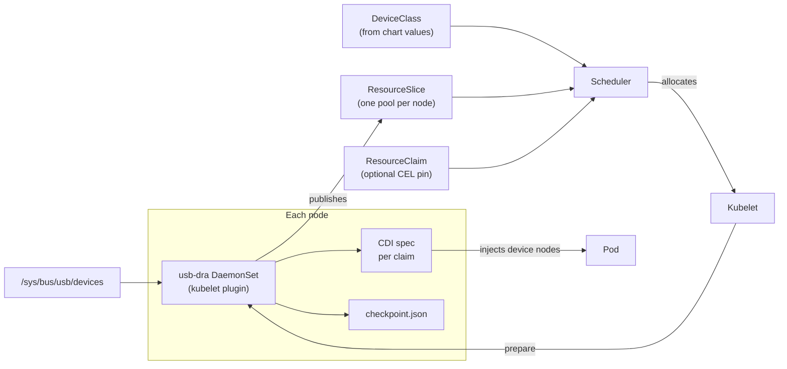

# usb-dra

A Kubernetes [DRA](https://kubernetes.io/docs/concepts/scheduling-eviction/dynamic-resource-allocation/)
driver (`usb.jacaudi.dev`) that publishes the USB devices attached to each node
as schedulable devices, the way a GPU is exposed. A pod asks for "a radio" or
"the LoRa board", or pins one physical device by serial or port, instead of
hardcoding a per-device resource name.

The driver does not decide what a device is. It publishes every eligible device
with stable identity attributes; a `DeviceClass` CEL selector on vendor and
product defines a device type.

> [!WARNING]
> **Agentically generated.** This codebase was produced through agentic,
> spec-driven development: each feature began as a written design and
> implementation spec, then a coding agent executed the plan under human
> review. Tests, code review, and CI gates apply as they would for any
> project, but the authorship pattern is not a single human contributor —
> keep that in mind when evaluating fit for your environment.

## What it does

A DaemonSet scans each node's USB bus and publishes every eligible device with
its serial, port, vendor and product. A `DeviceClass` names a device type, such
as an RTL-SDR or a RAK4631 LoRa board. A pod claims "any free device of this
class", or pins one by serial or port, and receives the device node and its
ttys at a stable path.

## Features

- **Pool or pin** — an unpinned claim draws any free device of its class; a CEL
  selector pins one device by serial or by port.
- **Stable identity** — devices are named by serial, or by port when there is no
  usable serial. Bus numbers and device nodes are never published, so a replug
  cannot silently select the wrong device.
- **Device types are values** — each `deviceClasses` entry in the chart values
  becomes one DeviceClass, selected by vendor and product. A plain install
  creates none.
- **Safe filter** — hubs and USB/IP devices are never published. HID, mass
  storage and wireless controllers are hidden by default; two flags change that.
- **tty injection** — each allocated device's USB node and ttys are injected,
  with a stable alias at `/dev/dra/<request>/tty<k>`.
- **Restart-safe** — prepared claims are checkpointed to disk and survive a
  driver restart.
- **Node-scoped writes** — the chart adds a ValidatingAdmissionPolicy so the
  driver on one node cannot write another node's ResourceSlices.

## Quick start

Prerequisites:

- Kubernetes 1.34 or later (`resource.k8s.io/v1`) with DRA enabled on the
  kubelet.
- `helm` and `kubectl`, and a checkout of this repository: the install reads
  `examples/values.yaml`.
- USB devices attached to the nodes you want to offer.

Install the chart:

```sh
helm install usb-dra oci://ghcr.io/jacaudi/charts/usb-dra -n kube-system -f examples/values.yaml
```

Three settings are not optional:

- **Namespace `kube-system`.** The pods run as root and privileged; a namespace
  that enforces baseline Pod Security rejects them while `helm install` still
  reports success.
- **At least one `deviceClasses` entry.** A plain `helm install` without `-f`
  deploys the driver but creates no DeviceClass, so no claim can select a
  device. `examples/values.yaml` defines `rtl-sdr` and `rak4631`.
- **One release per cluster.** The driver name, the plugin socket and the
  DeviceClass names are cluster-wide singletons.

Check that the driver is publishing:

```sh
kubectl get resourceslices
kubectl get deviceclasses
```

Each node shows one `usb.jacaudi.dev` pool, empty when the node has no eligible
devices. Plug in an RTL-SDR and a device named like `usb-0bda-2838-<serial>`
appears in that node's slice within the rescan interval (30 seconds by
default).

Then claim a device. This template asks for any one RTL-SDR; edit the
namespace, and reference the template from a pod's `spec.resourceClaims`:

```yaml
apiVersion: resource.k8s.io/v1
kind: ResourceClaimTemplate
metadata:
  name: rtl-sdr-any
  namespace: selfhosted
spec:
  spec:
    devices:
      requests:
        - name: radio
          exactly:
            deviceClassName: rtl-sdr.usb.jacaudi.dev
            allocationMode: ExactCount
            count: 1
```

`examples/claims.yaml` has this template and two pinned ones. Installing without
Helm, pinning a version and uninstalling are in
[Installing](docs/install.md). To install with Flux, use the HelmReleases in
`examples/helmrelease-rtl-sdr.yaml` and `examples/helmrelease-usb-printer.yaml`
([With Flux](docs/install.md#with-flux)).

## How it works



| Component | Role |
| --- | --- |
| `usb-dra` DaemonSet | Scans sysfs, publishes the node's pool, and on prepare resolves each device by name and writes its CDI spec. |
| ResourceSlice | One pool per node, empty when the node has no eligible devices. |
| DeviceClass | One per device family, rendered from the chart's `deviceClasses` values. |
| ResourceClaim | A pod's request: any free device of a class, or one pinned by serial or port. |
| CDI spec | Per claim: the USB node, ttys, aliases and `USB_*` variables. |
| `checkpoint.json` | Prepared claims, so state survives a driver restart. |
| ValidatingAdmissionPolicy | Lets the driver write only its own node's slices. |

## Documentation

**Using it**

- [Installing](docs/install.md): Helm, Flux and `install.yaml` installs, requirements and uninstall.
- [Configuration](docs/configuration.md): every chart value, and how to add a DeviceClass.
- [Selecting devices](docs/selecting-devices.md): unpinned and pinned claims, and safe CEL selectors.
- [Upgrading](docs/upgrading.md): moving from `rtlsdr-dra` or from the hand-written manifests.

**How it behaves**

- [Discovery](docs/discovery.md): which devices are published, and the filter flags.
- [Device identity](docs/identity.md): serial and port identity, and duplicate serials.
- [ttys and aliases](docs/ttys-and-aliases.md): what is injected into a container.
- [Prepared state](docs/prepared-state.md): the checkpoint, prepare rules and recovery.
- [Known limitations](docs/known-limitations.md): where a device assignment can go stale.

**Reference**

- [Device attributes](docs/schema/attributes.md): every attribute a selector can read.

**Contributing**

- [Development](docs/development.md): running the checks and what the Docker build does.

**Project**

- [Issues](https://github.com/jacaudi/usb-dra/issues): get help or report a bug.

## Credits

- [bjw-s common library chart](https://github.com/bjw-s-labs/helm-charts): the
  chart builds the DaemonSet, ServiceAccount and RBAC through it (5.3.0).
- [`k8s.io/dynamic-resource-allocation`](https://pkg.go.dev/k8s.io/dynamic-resource-allocation):
  the kubelet plugin helper the driver is built on.
